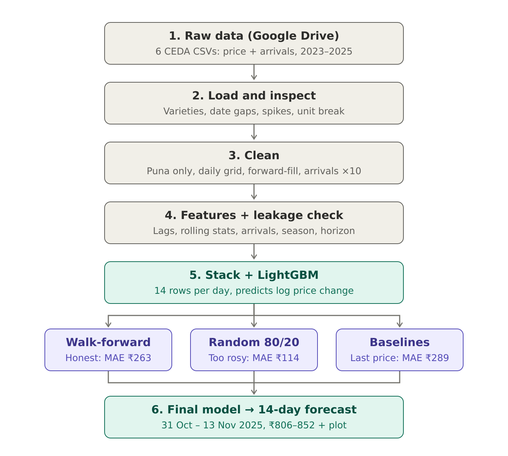

# Onion modal price forecast: Hubli (Amaragol) APMC

Forecasts the daily modal price of onion (Puna variety, ₹/quintal) at Hubli (Amaragol) APMC for the next 14 days, using CEDA Agmarknet price and arrivals data from Jan 2023 to Oct 2025.

## Pipeline

## Key results

| Evaluation | MAE (₹/quintal) | MAPE |
|---|---|---|
| Walk-forward (time-ordered) | 263 | 17.4% |
| Random 80/20 split | 114 | 7.0% |
| Baseline: last price | 289 | 18.4% |

14-day forecast (31 Oct – 13 Nov 2025): ₹806–852 per quintal. See `figures/02_forecast_vs_actuals.png`.

## Files

| File | What it is |
|---|---|
| `forecast_onion_notebook.ipynb` | Full pipeline, already executed |
| `forecast_onion.html` | Same notebook, viewable in a browser |
| `WRITEUP.pdf` / `WRITEUP.md` | One-page write-up |
| `figures/` | Pipeline diagram, raw-data plot, forecast plot, results and forecast CSVs |
| `data/` | The 6 raw CEDA exports (price and arrivals, 2023/2024/2025) |

## How to run (Google Colab)

1. Put the 6 CSVs from `data/` in a Google Drive folder.
2. Upload `forecast_onion_notebook.ipynb` to Colab.
3. In the first code cell, set `DATA_DIR` to that folder's path (folder icon → `drive` → `MyDrive` → right-click → Copy path).
4. Runtime → Run all, and allow Drive access when asked.

Locally: `pip install -r requirements.txt`, keep the CSVs in `data/`, and run the notebook.
